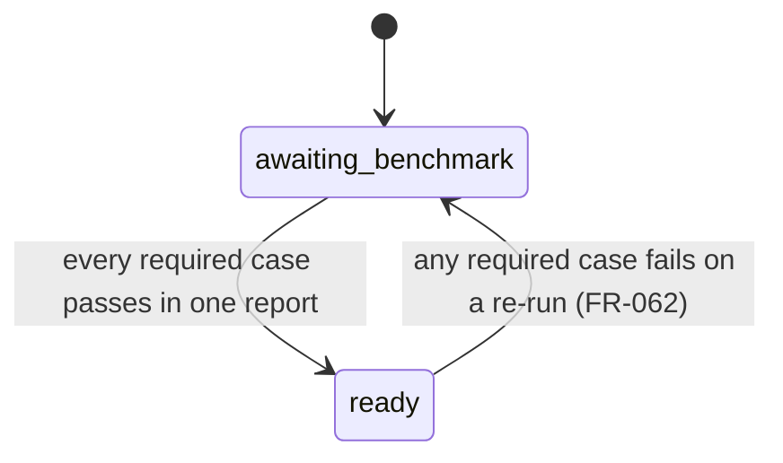
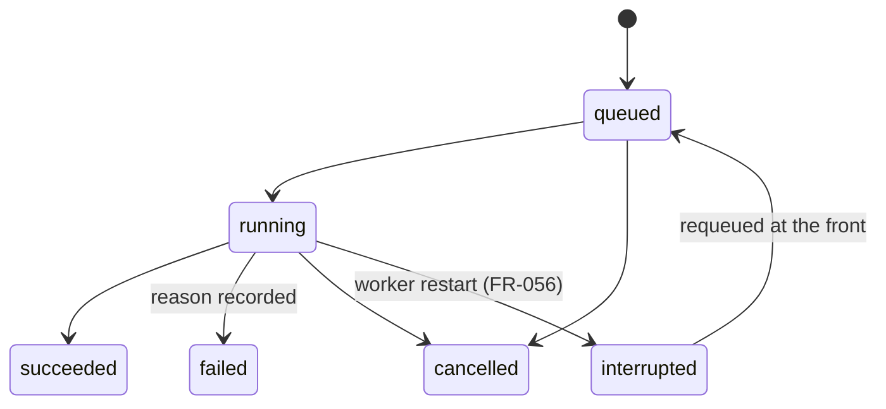
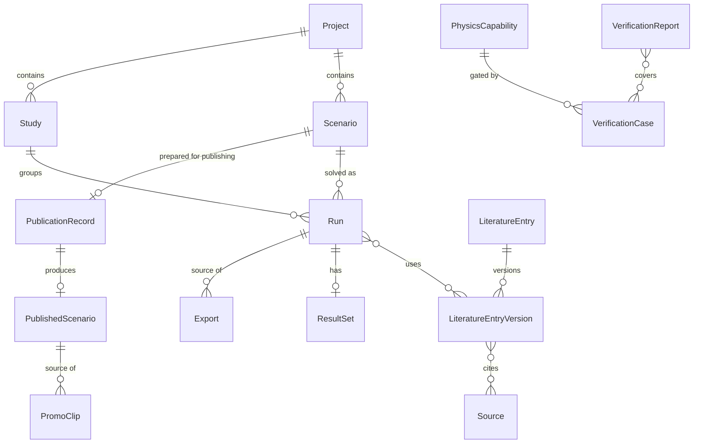

# Data Model: Simulation Studio (Phase 1)

**Feature**: [spec.md](spec.md) | **Plan**: [plan.md](plan.md) | **Research**: [research.md](research.md)

## Where data lives

| Location | What lives there |
|---|---|
| `studio.db` (SQLite, data folder) | Projects, scenarios, runs, studies, jobs, literature library, verification reports, publication records, user templates, settings |
| `store/` (data folder) | Content-addressed meshes, solver outputs and processed fields |
| Repository (git) | Engine code; block and template definitions; `docs/conventions.md`; verification case files; library proposals and snapshots; published scenario packages |
| `published-media/` (data folder) | Large published media, named by SHA-256 |

**Rules that apply everywhere**:

- **Identifiers**: every id is a ULID string (sortable by time).
- **Time**: all times are UTC in ISO 8601.
- **Units**: lengths in mm, forces in N, stresses in MPa, strains in µε (conventions document).
- **No patient data (FR-048)**: no entity has a field for patient identity or patient data, and the schemas
  forbid unknown fields.

---

## Conventions

**ConventionsVersion**: the parsed block of `docs/conventions.md`.

| Field | Type | Notes |
|---|---|---|
| version | semver string | Bumped whenever any value changes |
| content_hash | sha256 | Hash of the parsed block |
| units, frame, load_angle, regions, strain_measure, frost_scale, strength_rules, mesh_check_limit | objects | Sections as listed in research R6 |

- **Validation**: the block must parse; every region named by a block type must exist; every Frost window edge
  must point to an approved library entry.
- **Version change (FR-051)**: every Run and PublishedScenario with an older `conventions_version` gets the flag
  `needs_reverification`.

## Physics capabilities and benchmarks

**PhysicsCapability** is defined in engine code; its status is stored in the database.

| Field | Type | Notes |
|---|---|---|
| id | enum | `bonded_elastic`, `screw_preload`, `periodontal_ligament`, `contact`, `fatigue` |
| linear | bool | Whether superposition is allowed (R4) |
| required_cases | list of VerificationCase ids | The known-answer benchmarks that gate it |
| status | enum | `awaiting_benchmark` or `ready` |
| status_report_id | VerificationReport id | Present when `ready` |

**State transitions**:



When a capability goes back to `awaiting_benchmark`, the blocks and result types that need it lock again, and
published scenarios that use it are flagged `needs_review`.

A capability is ready for the solver build its passing report was made with. A run on another build (for
example a rented solver machine's, FR-064) needs a passing report made with that build (task T176).

## Building blocks and templates

**BlockType** is code: one module per type under `engine/src/dentalsim/blocks/`.

| Field | Type | Notes |
|---|---|---|
| type_id | string | For example `implant`, `crown`, `jaw_segment` |
| version | semver | Bumped when its geometry or settings change |
| settings_schema | JSON Schema | Each setting tagged with `group` (one of the 5 groups) and `kind` (`library` or `design`) |
| design_limits | per design setting | Minimum, maximum and allowed choices (FR-052) |
| attach_points | list | Where it can attach, for example `implant.platform → abutment.base`. A keyed attach point gives one socket per value of a list setting, named `<name>:<value>` (the jaw segment's `site:34`, `site:35`, … one per tooth of its region; slice 1b) |
| needs_physics | list of PhysicsCapability ids | FR-011a |
| result_types | list of ResultType | Each with its own `needs_physics`, for example screw stress needs `screw_preload` |
| report_regions | list of region ids | Taken from the conventions document |
| slice | enum | `1a`, `1b`, `story9:<physics>` |

**ProsthesisTemplate**: built-in templates are YAML files in the repository; owner templates live in the database.

| Field | Type | Notes |
|---|---|---|
| id, name | string | |
| prosthesis_type | enum | `single_crown_implant`, `single_crown_tooth`, `splinted_crowns`, `bridge_implant`, `bridge_tooth`, `bridge_mixed`, `cantilever_bridge`, `full_arch_fixed`, `implant_overdenture`, `rpd`, `complete_denture`, `custom` |
| branch | enum | `implant`, `tooth`, `removable` |
| fit_rules | list | Jaw-segment needs, for example minimum segment length or region (FR-011 "template does not fit") |
| blocks | list of BlockInstance | Pre-set settings |
| origin | enum | `builtin` or `owner` |

## Projects, scenarios, runs, studies

**Project**

| Field | Type | Notes |
|---|---|---|
| id, name | | |
| notes | text | Searchable with FTS5 |
| tags | string list | |
| created_at, updated_at | | |

**Scenario**: belongs to a Project.

| Field | Type | Notes |
|---|---|---|
| id, project_id, name | | |
| notes, tags | | Searchable |
| derived_from | {kind: template or scenario, id} | FR-032 "duplicate and change" |
| jaw_segment | BlockInstance | Required; the root of the assembly |
| blocks | list of BlockInstance | |
| loads | list of LoadCase | |
| detail_level | enum | `preview`, `standard`, `fine`, `extra_fine` |
| brand_comparison | object or null | FR-049: products, geometry sources, disclosures |
| revision | int | Incremented on every saved change |
| validity | ValidityResult | Cached result of the last check |

**BlockInstance**

| Field | Type | Notes |
|---|---|---|
| instance_id | string | |
| type_id, type_version | | |
| attach_to | {instance_id, attach_point} or null | |
| placement | {position_mm: [x, y, z], axis_angles_deg: {mesiodistal, buccolingual}, rotation_deg} | In the frame of the socket the block attaches to (for a block on the jaw, the conventions axes); the root block is not moved |
| settings | map of setting id → SettingValue | |

**SettingValue**

- A **design** setting is `{kind: design, value}`. It must lie within the block's design limits.
- A **library** setting is `{kind: library, entry_id, entry_version, choice, value, outside_range}`, where:
  - `choice` is `typical`, `source:<source_id>` or `custom`
  - `value` is the resolved number
  - `outside_range` is true when the value lies outside the entry's published range, and blocks publication
    (FR-052)
- **Validation**: the entry version must be `approved` at the time it is chosen. Any other status is refused.

**LoadCase**

| Field | Type | Notes |
|---|---|---|
| id, name | | |
| pattern | enum | `single_bite`, `chewing_cycle`, `clenching` |
| force | library SettingValue | |
| direction | {angle_deg, azimuth_deg} | Using the conventions sign |
| contact_points | list | {block instance, named occlusal point or surface coordinates, share} |
| cycles | library SettingValue | For `chewing_cycle` only |

**ValidityResult**

| Field | Type | Notes |
|---|---|---|
| ok | bool | |
| problems | list | {code, message, block instance, location_mm, severity} |
| checked_at, scenario_revision | | |

`code` takes one of these values:

| Code | Meaning |
|---|---|
| `overlap` | Parts overlap |
| `unsupported_pontic` | A pontic, cantilever extension or connector is not held: a pontic must be joined on both sides, a cantilever at its joined end, to a supported unit; a connector must reach a unit (slice 1b) |
| `in_nerve_canal` | An implant enters the nerve canal |
| `in_sinus` | An implant enters the sinus |
| `in_root` | An implant enters a neighbouring root |
| `exceeds_bone` | An implant is longer than the available bone |
| `template_misfit` | The template does not fit the jaw segment |
| `design_limit` | A design setting is outside the block's limits |

**Run**: one solve of a frozen scenario snapshot.

| Field | Type | Notes |
|---|---|---|
| id, scenario_id | | |
| scenario_revision | int | |
| snapshot | JSON | The fully resolved scenario, including every library value |
| detail_level | | |
| input_hash | sha256 | R14 |
| library_versions | list of {entry_id, version, content_hash} | FR-023 |
| engine_version | string | Package version plus git commit, for provenance only; `dev_build` true when the engine tree was dirty |
| engine_source_hash | sha256 | Hash of the result-affecting engine source; part of `input_hash` (FR-058) |
| conventions_version, solver_build_id, gmsh_version | | |
| solver_host | string or null | The rented solver machine that solved it (FR-064); null for the main PC |
| estimate | {dof, time_s, memory_gb, disk_gb} | |
| actual | {dof, time_s, peak_memory_gb, disk_gb} | |
| status | enum | `queued`, `running`, `succeeded`, `failed`, `cancelled`, `interrupted` |
| failure_reason | text | Plain-language reason |
| convergence | {force_balance: [{load_case, applied_n, reaction_n, relative_error}], energy_balance: [{load_case, external_work, twice_strain_energy, relative_error}], residuals: [{load_case, relative_residual}], solver_relative_residual, solver_messages} | FR-023; fails the run above the conventions `equilibrium_tolerance`, `energy_tolerance` or `residual_tolerance` |
| result_ref | store key | Present only when `succeeded` |
| locked_results | list of {result_type, missing_capability} | |
| flags | set | `out_of_date`, `uses_rejected_entry`, `outside_published_range`, `dev_build`, `needs_reverification` |
| study_id | optional | |
| created_at, started_at, finished_at | | |

**Run states**:



- Only `succeeded` runs have results, and `failed` runs never show partial fields (FR-022).
- **Publishable**: a run is publishable only if it is `succeeded` and none of these flags is set:
  `out_of_date`, `uses_rejected_entry`, `outside_published_range`, `dev_build`, `needs_reverification`.

**Preview**: not a Run; never publishable (FR-017).

| Field | Type |
|---|---|
| input_hash | sha256 |
| scenario_id, scenario_revision | |
| result_ref | store key |
| accuracy_note | text, from the verification cases (R7) |
| created_at | |

**ResultSet**: stored in `store/` under the input hash.

| Field | Type | Notes |
|---|---|---|
| fields | list | Per part: displacement, stress tensor, strain tensor at integration points and nodes, per unit load case |
| combined_cases | list | Load cases combined by superposition (linear physics only) |
| key_numbers | list of KeyNumber | |
| visual_assets | list | `.glb` per part and load case |

**KeyNumber**

| Field | Notes |
|---|---|
| id, label | |
| block instance, region, side | Side is the worse side by the sector rule |
| statistic | `mean` or `p95` |
| value, unit | |
| reference | {library entry/version, kind: `strength` or `frost_window`} |
| percent_of_reference | |

**Study**

| Field | Type | Notes |
|---|---|---|
| id, project_id, base_scenario_id | | |
| kind | enum | `sweep` or `sensitivity` |
| axes | list | For a sweep: {setting path, values}. For sensitivity: {library setting path, [min, typical, max]} |
| run_ids | list | |
| status | enum | `queued`, `running`, `finished`, `finished_with_failures`, `cancelled` |
| summary | object | Spread of each key number per axis |

**Job**: the worker queue.

| Field | Type | Notes |
|---|---|---|
| id | | |
| lane | enum | `heavy` or `preview` |
| kind | enum | `run`, `preview`, `mesh_check`, `verification`, `export`, `promo`, `interactive_data` |
| payload_ref | | |
| position | int | |
| status | | Mirrors the target's status |
| pid | | Solver process id while running |
| heartbeat_at | | |
| attempts | int | |

## Literature library

**Source**

| Field | Type | Notes |
|---|---|---|
| id | | |
| authors | list | First author's surname is required |
| year, title, journal | | |
| doi, pmid | | At least one is required |
| study_type | enum | `experimental`, `clinical`, `fea`, `review`, `standard`, `textbook` |
| check | {status, checked_at, matched: {authors, year, title_similarity}, resolver} | `status` is `not_checked`, `resolved_match`, `resolved_mismatch` or `unresolved` |

**LiteratureEntry**: the parameter identity.

| Field | Type | Notes |
|---|---|---|
| id | | |
| parameter_key | string | For example `bone.cancellous.E.D4`, `material.titanium_g5.yield`, `load.bite_force.molar` |
| category | enum | `material`, `bone`, `load`, `strength`, `frost_window` |
| current_version | int | |

**LiteratureEntryVersion**: immutable once approved.

| Field | Type | Notes |
|---|---|---|
| entry_id, version | | |
| units | | Must match the parameter's dimension in the conventions |
| typical | number | Must lie within the range |
| range_min, range_max | numbers | |
| values_by_source | list of {source_id, value, note} | |
| notes | text | |
| status | enum | `proposed`, `approved`, `rejected`, `superseded` |
| origin | enum | `claude_proposal` or `owner` |
| proposed_at, approved_at, rejected_at | | |
| content_hash | sha256 | |

**Entry version states**:

```mermaid
stateDiagram-v2
    [*] --> proposed
    proposed --> approved : every source is resolved_match (FR-054)
    proposed --> rejected
    approved --> superseded : owner edits; a new proposed or approved version is created (FR-016)
    approved --> rejected : runs that used it are flagged (FR-055)
```

- Only `approved` versions can be selected (FR-014).
- Superseded versions stay readable for traceability.
- **Rejecting a used version (FR-055)**: every Run that used it gets `uses_rejected_entry`.

## Verification

**VerificationCase**: a YAML file in `content/verification/cases/`.

| Field | Type | Notes |
|---|---|---|
| id, title | | |
| kind | enum | `textbook` or `published_study` |
| capability | PhysicsCapability id | The capability the case gates (read by the physics registry) |
| required | bool | |
| model | {builder, parameters} | Or a scenario definition |
| quantities | list | {id, description, expected, expected_source, compare: `absolute`, `relative` or `ratio`, tolerance} |
| source | Source | For a published study |
| tolerance_changes | list | {date, from, to, reason} |

**VerificationReport**

| Field | Type | Notes |
|---|---|---|
| id, created_at | | |
| engine_version, solver_build_id, conventions_version | | |
| case_results | list | {case_id, case_file_hash, quantity_id, expected, computed, tolerance, pass} |
| preview_accuracy | {max_relative_difference, per_case} | Feeds FR-017 |
| overall | enum | `pass` or `fail` |

**MeshCheck**

| Field | Type | Notes |
|---|---|---|
| id, scenario_id | | |
| levels | [level_a, level_b] | |
| run_ids | | |
| key_number_changes | list of {id, relative_change} | |
| limit | | From the conventions document |
| pass | bool | |

## Publication

**PublicationRecord**: the working state for one Scenario.

| Field | Type | Notes |
|---|---|---|
| scenario_id | | |
| slug, title | | |
| branch, prosthesis_type | | |
| situations, keywords | lists | |
| teaching_message | string | One sentence |
| explanation | markdown | |
| assumptions_note | object | FR-061 fields |
| verification_note | object | FR-060 fields, including the mesh check or carry-over, convergence, report id and literature comparison |
| references | list of Source ids | |
| access_level | enum | `free`, plus future tiers |
| sign_off | {by: owner, at} | |
| frame_review | {at, desktop_ok, phone_ok} | |
| run_ids | list | The runs the package is built from |
| interactive_data_ref | optional | |
| checklist | computed list of {item, ok, detail} | |

**PublishedScenario**

| Field | Type | Notes |
|---|---|---|
| slug | | |
| versions | list of {version, path in repo, published_at, package_hash} | |
| state | enum | `published` or `unpublished` |
| history | list | {action: publish, republish or unpublish, at, version, note} |
| flags | set | `needs_reverification`, `needs_review` |

**Checklist items (FR-045)**: publishing is refused unless all of these hold.

- the verification note is complete
- the assumptions note is complete
- the owner has signed off
- the frame review is done on desktop and on a phone
- the test gate passed for the current engine version
- the teaching-only notice is present
- every input is an approved library version
- no run carries a blocking flag
- the published scenario carries neither `needs_reverification` nor `needs_review` (FR-051, FR-062); both
  are cleared only by this republication, from runs under the current conventions and ready capabilities
- every required verification case passed (FR-036)
- brand rules hold (FR-049)

A refusal lists every failing item.

**PromoClip**

| Field | Type | Notes |
|---|---|---|
| id, published_slug, published_version | | |
| script | {text, approved_at} | |
| voice | {model, version, licence} | |
| duration_s | | 15–45 |
| media_ref | | |

**Export**

| Field | Type | Notes |
|---|---|---|
| id | | |
| kind | enum | `figure`, `film`, `slide_loop`, `pptx`, `report`, `spreadsheet`, `promo`, `interactive_data` |
| source | {run_ids, comparison} | |
| template_version | | |
| options | | |
| output_ref | | |
| created_at | | |
| regenerable | bool | Always true; regenerated from the source and template version |

## Relationships


